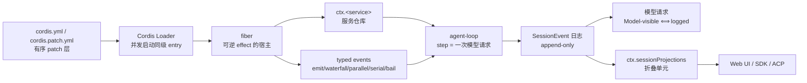
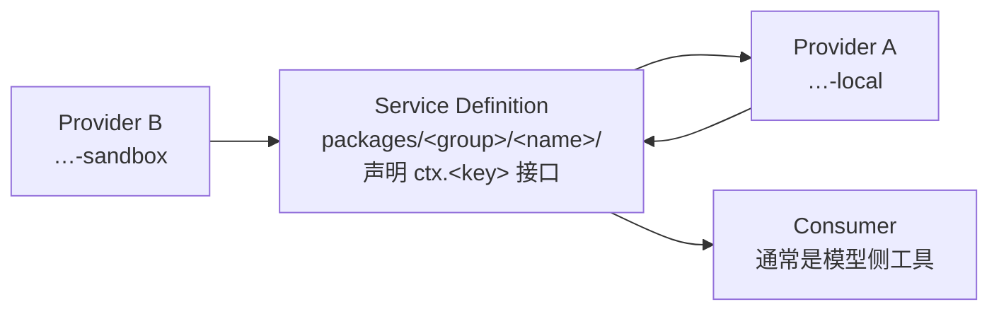

# Repository Guidelines

## Current development boundary

Use DS-Bot as the application base and dsh 0.2.1-rc.5 as its runtime. `ds-bot/`
is a read-only Git submodule pinned to upstream v0.2.7. It contains the DS-Bot
plugin and desktop application; dsh is an npm dependency, not a source tree
inside that submodule. `external-plugins/dsh-motion-ui/` is also read-only and
is pinned to v0.8.9, which declares rc.5 compatibility.

Implement customizations in this repository's `plugins/` and `profiles/` through
Cordis registrations and overlays. Preserve both upstreams unchanged. A backend
service such as userQuestions, approval, settings, or commands remains available
when removing visible UI. UI removal targets browser rendering and shell code.

Unused local plugins live in `plugins/archived/`. Active packages are grouped
by role: `plugins/workbench`, `plugins/context`, `plugins/judgment`,
`plugins/onlyne`, `plugins/compute`, and `plugins/host`. `plugins/node_modules`
is still the shared resolution root — Node walks up from
`plugins/<group>/<pkg>/src` to it — so sibling imports by package name keep
working. Keep old profile dependencies that reference archived locations
separate from the new DS-Bot composition. The Lean experiment and its companion
documents live in `archived/`. They are historical artifacts, not a development
gate or a claim of TypeScript implementation correctness. Validate current
changes through runtime composition and the behavior exercised by the change.

Two upstream packages carry their own runtime dependencies, and neither
submodule ships them. Install each once after a fresh checkout:

```sh
cd ds-bot/ds-bot && pnpm install --prod --ignore-scripts --lockfile=false --config.auto-install-peers=false
cd external-plugins/dsh-motion-ui && pnpm install --prod --ignore-scripts --lockfile=false --config.auto-install-peers=false
node plugins/link-host-runtime.mjs
```

The last line links the host packages a plugin imports by bare name (including
`@deepseek-ai/dsh-scope`, which DS-Bot's host half imports) into the three
module roots: `plugins/`, `external-plugins/`, and the repository root. The
Onlyne plugins live at `plugins/onlyne/omd-onlyne`,
`plugins/compute/omd-compute`, and `plugins/compute/omd-issue-runner`. The
script links those unscoped names, plus the siblings they import, into
`plugins/node_modules`. `@onlyne/lib` is the published npm package `^3.2.0`;
the script installs it from `plugins/npm-packages` into `plugins/node_modules`.
Set `ONLYNE_ROOT` to a local Onlyne checkout to use
`<ONLYNE_ROOT>/packages/lib` instead.

## Project Overview

我把这个项目的全部内容定义成一句话：**定制 dsh 就是写插件**。所以我给自己定的唯一架构原则是——

> 每个能力是一个高内聚的插件；插件的每一次注册都是可逆 effect，卸载即回滚；能拆的拆到不能再拆，但拆到"还能用"为止。

定制从上游 Web 组合开始，随着实际使用逐项添加。已有自定义和社区插件保留文件与安装依赖，当前全部解除挂载。每次只启用当前需要的能力，不整体恢复 `omd-core`。

`refs/deepseek-harness/` 是上游的**只读**检出（commit `687f282e8625c6b8d11ff58211a90524be2e4317`，tag `dsh-v0.2.1-rc.2`，稀疏检出）。**我不在里面改任何一行**。它和 `refs/papers`、`refs/raw` 一样放在 `refs/` 下，整个目录被 git 忽略。理由不是洁癖：上游 README 明写 `THERE WILL BE COMPATIBILITY-BREAKING CHANGES.`，过去 42 天发了 24 个预发布 tag，没有 GA。改上游 = 每周重新合并一次；写插件 = 只在自己的 profile 里增删一行。

当前状态：检出里的 `node_modules` 已按 `pnpm install --frozen-lockfile` 装好，但与源码同版本的 `pnpm run build` 我还没有完整跑过。本文件里的命令凡是我实测过的，都在下面标注了；没标注的读自 `refs/deepseek-harness/package.json` 与它自己的 `AGENTS.md`。运行时用的是全局安装的 `dsh`（`/opt/homebrew/bin/dsh`，0.2.1-rc.2），不是这份检出的源码。

我同时维护 Alexandria 知识库（`refs/raw` / `refs/papers` 两个软链指向它）里这两份资源的精读：`refs/papers/readings/2026-09/agent-harness/github/deepseek-harness-reading.md` 与 `refs/papers/readings/2026-09/agent-harness/arxiv/cordis-reading.md`。**要动代码前先读对应的 reading 页**——它解释了为什么是这套架构，我按它的结论写插件。

---

## Architecture & Data Flow

### 运行时

dsh 是一棵 Cordis 插件树，没有特权内核。数据流是一条单向链：



三条承重不变量，我写插件时逐条对照：

1. **Model-visible ⟺ logged**（`AGENTS.md:136`）。任何进入模型请求的输入必须能从会话日志重建；新增模型可见输入 = 新增一条 session 事件。只有 UI 装饰的东西才不必落事件。
2. **注册即 effect**（`AGENTS.md:131`）。所有贡献走 `ctx.effect()` / `ctx.on()`，注册表 `register()` 返回 disposer。`ctx.on` 内部就是 effect，不需要手工反注册。
3. **加载顺序无关**（`.agents/notes/implemented/architecture/2026-07-05-subagent-provider-lifecycle-events.md`）。Loader 并发启动同级 entry 且不 await 激活；依赖用 `inject` 声明，**绝不在 `apply` 时刻解析 provider**——那等于偷偷引入一条顺序要求。

### 我的定制落点：两处 lever，都是数据

| lever | 手段 | 什么时候用 |
|---|---|---|
| **组合面** | 往 profile 的 `cordis.patch.yml` 加一行 / 改一行 | 换模型、换默认工具集、改提示词、停用某能力 |
| **接缝** | 换 `ctx.<key>` 的 Service Provider 实现 | 执行环境进远端沙箱、文件走 SSH、模型走自家网关 |

**两条都不要写进上游。** 改一行 YAML 和写一个包，是这件事的两种粒度，不是两种风格。

### 拆分的判据

我拆插件，但不盲目拆。上游的判据我直接继承（`docs/cookbook/adding-a-package.md:44`）：

> 对于可替换能力，**当三个角色各自独立演进时**才拆成三个包；单一用途的插件保持一个包。

三元组是完整接缝，缺一不可（`packages/AGENTS.md:10`）：



- **Definition** — 抽象类 + `declare module` 里的 `ctx.<key>` 声明，文件末 `export default`。
- **Provider** — 继承 Definition，`super(ctx)` 即注册（**不写 `apply`，不写 `ctx.provide`**），文件末 `export default`。
- **Consumer** — 命名导出 `name` / `inject` / `Config` / `apply`，**绝不 `export default`**。

照抄 `ctx.fs`：`packages/fs/fs/`（Definition）· `packages/fs/fs-local/`（Provider）· `packages/fs/fs-sandbox/`（默认 Provider）· `packages/fs/tool-fs/`（Consumer）。

**我自己的拆分偏好**（在 dsh 判据之上）：宁可多拆一个纯组合包，也不要在一个包里塞两个能独立回滚的能力。理由是可卸载性——`ctx.effect` 逆序 unwind，合成一个包就合成一条回滚链，拆开才能只回滚其中一个。

### 界面归属：一个包，界面半边放里面（2026-10-22 改）

只保留一个界面：`omd`（web）。之前的 host / client 双包规定随终端界面一起取消——profile 之间不能继承（上游 `2026-08-05-profile-plugin-bundles.md` 把模板继承列在否掉的方案里），多一个界面就多一份独立的依赖安装与组合清单，共享不到东西。

1. **一个能力一个包。** 需要给人看的界面就加同一个包的 client 半边：`src/client/` 加 manifest 的 `dsh.client: { platform: 'web' }`，宿主入口仍是 `src/index.ts`。不再有 `<name>-ui` 包。
   **client 入口必须是纯 JavaScript（`.js`）。** web 壳把 `./client` 文件的字节直接拼进 `__ModuleLoader__.load({factory})` 交给浏览器，中间没有 TS 构建步骤；写成 `.ts` 会在浏览器里因类型语法直接失败（2026-10-22 实测于 `omd-project-config`）。manifest 写 `exports["./client"] → ./src/client/index.js`，文件手写成 module-loader factory 形式；宿主半边仍然是 TS。
2. **client 半边只是同一份数据的另一种画法。** 它不拥有状态、不写会话日志、不产生模型可见输入。数据从 `ctx.sessionProjections`、服务接口、工具结果自带的 `presentationMeta` 来。
3. **client 半边不 import `node:` 内置模块**；宿主半边不 import client 的任何东西。
4. **`dsh.client.platform` 只写 `web`。**
5. **验收方式**：能力本身在 `omd` 里通过工具或服务验收；界面在 `omd` 的网页里看得见。宿主功能的测试不许依赖浏览器。
6. **只有 Web 端**：DS Bot 的 Electron 壳已拆除，插件只需要在 DSH Web（以及 DSH Desktop 那套同样的 web-app bundle）里工作，不为任何单独宿主做逻辑。

### 发布与配置：机器无关，一切走配置项（2026-10-22 定）

`omd` 将来要发布给别人，所以仓库里不出现只在本机成立的默认值。

1. **插件默认值必须机器无关。** 网关地址、绝对路径、凭据、个人模型 id 都不许写进插件的 `Config` 默认值。默认值只表达"没配置时是什么状态"：例如空候选列表意味着判断模型不可用、工具不注册，而不是指向我自己的网关。
2. **本机取值只住在 profile。** 具体地址、模型、密钥环境变量名写进 `~/.dsh/profiles/omd/cordis.patch.yml` 的 entry `config`，或由用户在自己的配置里给。
3. **每个可调项都是 `Config` 字段**，JSDoc 写清单位与默认值。需要运行时改的字段加 `.volatile()`，注意它的契约：schemastery 把该字段解析成 `Volatile<T>` 引用，读值必须走 `.get()`，改值由 Loader 提交进同一个引用、不重挂。没有配套的 `.get()` 读法和面板之前不要加，加了就是 `config.x.map is not a function`（2026-10-22 实测）。
4. **面板自己做。** dsh 只有配置数据面（`@deepseek-ai/dsh-settings` 加 `config-editor`：按 profile entry id 出表单、脱敏、拒绝过期写入），随包发的 web 客户端没有通用渲染器（`packages/settings/settings/README.md:39`：`autoGenerate` 默认开，但 "no shipped client does so yet"）。需要界面时写自己的 client 半边，从 schema 生成，不手写字段表。

---

## Key Directories

```text
oh-my-dsh/                       本项目根（AGENTS.md 在这里）
├── refs/                        只读参考材料，整目录被 .gitignore 排除
│   ├── deepseek-harness/        上游检出（packages/apps/vendor/native/docs/scripts/.agents/patches）
│   │   ├── packages/            @deepseek-ai/dsh-<name>，布局 packages/<group>/<pkg>/
│   │   ├── vendor/cordis/       vendor 的 Cordis 4.0.4（自有版本线）
│   │   ├── apps/                cli / desktop / desktop-host / web
│   │   ├── docs/                架构、接缝表、cordis-primer、cookbook、testing
│   │   ├── scripts/             ~280 个生成器与门禁脚本
│   │   └── .agents/notes/       决策日志（199 篇 architecture 决策）
│   ├── raw -> Alexandria/raw    知识库资源层（软链）
│   │   └── <资源>/assets/       资源自带的非文本资料（见下）
│   └── papers -> Alexandria/papers  知识库页面层（软链）
├── plugins/                     树外插件，按角色分组
│   ├── workbench/               窗口与面板
│   ├── context/                 笔记、酒馆、记忆、技能
│   ├── judgment/                判官、角色、回合规则
│   ├── onlyne/                  Onlyne 总线
│   ├── compute/                 沙箱、租约、issue runner、worktree
│   ├── host/                    内部路径与其上的工具
│   └── archived/                未挂载的旧包
├── external-plugins/            第三方 dsh 插件，逐个作为 git submodule 钉版本
├── profiles/omd/                发布用 Web 组合（npm 依赖，不带 Magpie 块）
├── profiles/omd-full/           开发用桌面组合（link: 指向本仓库插件）
├── scripts/                     pack-desktop、publish-all、内部路径 CLI
└── docs/                        设计说明
```

### 非文本资料放 `refs/raw/<资源>/assets/`

Alexandria 已有这个位置，我不再新开目录：`refs/raw/<YYYY-MM>/<学科>/<刊名>/<slug>/assets/`。判据三条，同时满足才放进去——

1. **非文本**：PDF、位图这类不能直接当 Markdown 源读的东西。Markdown 页面、抽取文本、HTML 快照、原始 PDF 本体**都不算**，它们留在资源层或页面层。
2. **可被人读**：产物本身能独立阅读，拿到文件不需要我额外解释。
3. **可被报告或 wiki 界面引用**：它是页面引用的目标，不是过程产物。典型是在 reading / wiki 页面里 `![[raw/.../assets/xxx.pdf]]`。

只在本地看一眼、没人引用的中间产物放进项目外的临时目录，不进 `assets/`。出处与再生成方式记进该资源的 `MANIFEST.md`。

已用的一条：`refs/raw/2026-09/agent-harness/github/deepseek-harness/assets/dsh-module-graph.pdf`（30 页 A3，模块图打印版），被 [[deepseek-harness-reading]] 引用。生成它的脚本已随 `mkconfig` 一起删除，这份 PDF 只作存档。**模块图以后不再生成。**

**最常读的上游文件**（按对我写插件的相关度）：

| 文件 | 用途 |
|---|---|
| `refs/deepseek-harness/docs/capability-seams.md:578-672` | `ctx` 键 → 角色 → 属主 → 实现 → 消费者。接缝清单的权威来源 |
| `refs/deepseek-harness/docs/cordis-primer.md` | 五个核心概念、五种 dispatch 模式、`!!js` 插值语义 |
| `refs/deepseek-harness/packages/AGENTS.md` | 插件作者专属纪律（19 条），比根 AGENTS.md 更贴我的场景 |
| `refs/deepseek-harness/docs/postmortem/0001-acp-default-export-drops-inject.md` | default export 吃掉命名空间的真实事故 |
| `refs/deepseek-harness/docs/postmortem/0002-js-expression-disabled-filesystem-tools.md` | `!!js` 放错位置导致工具永久停用，且快照测试全绿 |
| `refs/deepseek-harness/docs/cookbook/adding-a-package.md` | 建包流程 + 命名角色词表（Controller/Store/Registry/Provider/…） |
| `refs/deepseek-harness/docs/testing.md` | 分层、真实实现优先、with-key 政策、何时必须补快照 |
| `refs/deepseek-harness/.agents/notes/implemented/architecture/*.md` | 决策日志。动手前先搜有没有同类决策 |

---

## Development Commands

**我的脚本**：没有了。早期那套 `mkconfig` 模块选择与过滤构建脚本已删除——dsh 没有模块选择这回事，组合由 `dsh.profile.bundles` 决定，构建用上游自己的 `pnpm run build`。

**上游命令**（未实测，读自 `package.json`）：

```sh
cd refs/deepseek-harness
pnpm install                    # pnpm@11.7.0，node ^22.19.0 || >=24.0.0
pnpm run build                  # tsx scripts/build.ts → native → lib:host → lib:client → web
pnpm run test                   # 单元测试
pnpm run test:coverage          # 覆盖率门禁：packages/*/*/src 逐文件 100%
pnpm run typecheck && pnpm run lint
pnpm run hygiene                # publint + workspace/包/依赖检查 + NodeNext 消费检查
pnpm run doc-sync               # 文档门禁
pnpm dsh --profile headless "task"   # 从源码跑一次任务（需 DEEPSEEK_API_KEY）
pnpm run dev:web                # 构建 + 启动，编辑时重建 client bundle
```

`scripts/build.ts` **只能**通过 `pnpm run build` 启动——它从 `npm_execpath` 取包管理器入口，直接 `tsx scripts/build.ts` 会在第一步抛错。

---

## Code Conventions & Common Patterns

### 硬性红线（违反了会坏，不是风格问题）

1. **命名空间插件里绝不能有 `export default`。** Loader 的 `unwrapExports` 做 `exports.default ?? exports`，default 一出现就丢掉整块命名空间，`inject`/`name`/`Config` 全失效，报错形态是加载期首个 `ctx.<svc>` 读抛 `cannot get property "agents" without inject`。（`vendor/loader/src/index.ts:201-208`，postmortem 0001）
2. **可选服务一律 `ctx.get(name)`，不用 `ctx.<name>` 属性代理。** 属性代理只沿 fiber 祖先链向上找，兄弟分支不可见；`ctx.get` 读全局服务仓库。（`packages/AGENTS.md:6`）
3. **waterfall 监听器必须调 `next()`。** 不调就是短路，而且会把内建行为一起短路。只有"自己拥有该决策"的单决策事件才允许不调。（`AGENTS.md:135`）
4. **模型可见的输入必须先是会话事件。** 产生消息的事件要带 `surfaceOp`，替换要列全被遮蔽的节点。
5. **一个 context 里不挂第二个实现。** Cordis 直接抛 `service "x" has been registered at <…>`。要并行两套用 `isolate`。
6. **树外插件的宿主运行时进 `peerDependencies` + `devDependencies`，绝不进 `dependencies`。** 否则模块被装两份，模块级 Symbol 不匹配，运行时才炸。
7. **禁止新增 `as unknown` / `<unknown>` 断言。**
8. **配置错误要响亮失败。** 自包含的错在加载期抛；否则在最早可解析点抛。绝不静默跳过缺失的引用。
9. **插件里不许有硬编码可调参数。** 部署会变的必须是 `cordis.yml` 可改的 `Config` 字段；`DEFAULT_*` 常量或测试钩子**不算**可配置。协议常量、外部规范、安全不变量保持固定。
10. **`cordis.yml` 里只有插件 `config` 与 entry `disabled` 吃 `!!js`**，且必须写 `!!js` 不是 `!js`；其他 entry 元数据保持字面量。条件组合走 overlay 文件。（postmortem 0002 的直接教训）

### 导出形态（二选一，不许混）

```ts
// 服务类插件：default 是必须的
export class LocalFileSystem extends FileSystem {
  static Config: z<Config> = z.object({ cwd: z.string().default(process.cwd()) })
  constructor(ctx: Context) { super(ctx) }   // super 即注册
}
export default LocalFileSystem
```

```ts
// 函数 / 命名空间插件：default 是禁忌
export const name = 'tool-fs'
export const inject = ['tools', 'fs', 'systemPrompt']
export const Config = z.object({ /* 每个字段都要 JSDoc */ })
export function apply(ctx: Context, config: Config): void { /* ... */ }
```

### "我现在还不能激活"的四种正确说法

| 手段 | 语义 |
|---|---|
| 声明 `inject` | 依赖没齐 → fiber 停在 `PENDING`，**不是错误** |
| `ctx.inject(deps, cb)` | 回调在某组服务齐备时才跑 |
| `[Service.check]` / `ctx.provide(name, value, check)` | 服务存在但自报当前不可用 |
| 抛异常 | fiber `FAILED`，`fiber.await()` 会重抛 |

### 命名

- 包：`@deepseek-ai/dsh-<name>`，落在 `packages/<group>/<pkg>/`（我的插件在自己目录，不必进这个布局）。
- 服务键：单引擎/策略/控制器用单数 `ctx.<key>`；注册表或多命名成员用复数。类名与键的数一致。host 与 client **不得复用同一个 `Context` 键**。
- 角色词按 `adding-a-package.md:52-70` 的词表选：它收命令改状态用 `Controller`、管一份数据集用 `Store`、管一组命名注册用 `Registry`、供一个实现用 `Provider`。**不要只因为类继承了 Cordis `Service` 就叫 `Service`。**
- 实现包名加机制/协议/环境/厂商限定（`fs-sandbox`、`subprocess-ssh`）；`local` 只在"同主机执行属于契约"时用。

### Internal paths and tool interfaces

Every surface that a user or agent can read or write must have a described file or directory address in the internal-path registry. Every tool must be discoverable there with its purpose, input contract, and supported operations. Use `dsh-resource://<source>/<path>` as the canonical address.

The owning plugin registers the content and operations once. Browser views and model tools use that same host implementation. Persistent model-visible changes are session events, and the view reads their projection. A browser view must not own a second copy of authoritative state.

Implement tools as wrappers over internal-path reads and writes whenever those operations express the capability. Reuse the existing `read`, `write`, and `edit` tools. Add a dedicated tool only when path operations cannot express its contract. Keep the model-facing tool list small.

Every action request goes through the judge, including requests that name an explicit path and operation. `omp-hindsight` is the reference implementation; its contract wins over Onlyne's `msg` where the two differ.

- The entry takes `intent`, optional `path`, optional `meta`, and payload (`content`) that never enters the judge state.
- The judge sees the intent, the path and meta, and the described paths available to this agent. It returns the operation and target, including an `explicit` outcome that executes the reference as written.
- Decisions are cached by the request's hash, so an explicit request repeated verbatim costs no second call.
- Below the confidence gate the entry returns an `unresolved` receipt with a suggested next call. It does not guess.
- A failed or unavailable judgment returns a structured error and never falls back to heuristic routing.
- Execution after the decision is mechanical: resolve the path, check the capability, permissions, and cancellation, then run the same provider the browser uses.
- Exact inventory and state questions that the host can answer verbatim (which sources exist, a tool's schema, a surface's capabilities) are served from the described paths without a judge call, as hindsight does for system-meta reads.

The judge is a language model that answers with probability distributions instead of prose. It reasons about situations, and it is a peer rather than a rule engine.

- Its instructions explain why the decision matters, what the caller is trying to accomplish, and what happens under each choice. Do not hand it a table of terse regex-like rules and enum names.
- Its state carries the situation: what this session is doing, what each candidate surface is for, who owns it, and what the caller already fixed through `meta`.
- Ask independent questions in one call. Keep labels short, and let the criteria text carry the reasoning.
- Do not spend a judge call on normalization, path resolution, or validation the host can do exactly. Do not pre-decide a judgment and then dress it as a question.

An internal path preserves the capability's existing scope, permissions, cancellation, and error contract. Descriptions must state which content is readable, which is writable, and which identity owns it. Stale writes must report a conflict rather than overwrite a concurrent change.

### 模型可见的命名

工具名是模型选工具时的索引。模型在训练里没见过的名字等于不存在，再好的工具也不会被调用。凡是需要模型自己决定调用的工具，名字只用通用词。

1. **用通用动词**：`read`、`write`、`edit`、`bash`、`glob`、`grep`、`todo`、`task`、`web_search`、`fetch`、`ask`、`judge`。
2. **不加产品前缀，不自造词**：`omd_read`、`xdev_edit`、`file_reader`、`ast_apply`、`exit_plan_with`、`context_notes` 这类名字没有先验，调用率接近零。
3. **同名工具靠参数与配置区分**：两个阶段（暂存 / 提交）用一个工具加 `action`，两套行为用一个工具加 `mode` 或 `Config` 字段，不要为此新开一个名字。
4. **参数名也用通用词**：`path`、`content`、`command`、`pattern`、`offset`、`limit`。不要造 `file_path_or_uri`、`target_spec`。
5. **不受此限的**：斜杠命令（人输入的）、服务键、`Config` 字段、投影键、事件名、包名。它们不进模型视野，照旧用本项目的词。

### 替换上游工具必须进 agent 作用域（2026-10-22 实测）

上游把 `tool-fs`、`tool-todo` 这类工具挂在 **agent preset** 的 `config.plugins` 里。预设挂在自己的 generation scope，`agentPresetRegistry.join` 把它绑成 agent scope 的**父**层，因此比全局更近。后果有三条，每条都踩过：

- profile 里 `- id: tool-fs / config: read: false` 只作用于顶层行，管不到预设子项——我们以为关掉了，其实没有。
- 同名工具在全局层重新注册**不会生效**，模型仍拿到预设那份。`omd-read` 就这样被遮蔽了几个小时，所有 `--dump-config` 验证都是绿的。
- `--dump-config` 看不到这件事：它反映组合，不反映作用域。

正确做法：插件在 `agent/created` 时把定义再注册进该 agent 自己的作用域（最近的一层胜出），注册随 `agent.ctx` 自动 dispose。注意 `agent.ctx.tools` 属性访问会抛 `cannot get property "tools" without inject`，要用 `agent.ctx.get('tools')?.register(...)`。同名跨作用域允许，同一层重复注册会抛 `tool "<name>" is already registered in this scope`。

验收标准随之改变：**读真实会话日志里的 `request/header` tools，确认描述与参数 schema 是新版**。只跑 `--dump-config` 或看界面卡片都不算——界面按工具名匹配，被遮蔽的实现同样会命中我们的卡片。

### 提示文本与命令的覆盖（2026-10-22 实测）

`restrict` 只从模型面移除 schema，**不移除提示文本**：deny 掉 `create_goal` 之后，system prompt 仍在教模型怎么用它，模型看到“应该用某个工具”而工具不在清单里，比多留一个工具更糟。

- sections 与 commands 都走 `ScopedLayers.merge`：global → 远祖先 → 近祖先 → 当前 scope，**近层同名覆盖**，同一层重名才抛错（`refs/deepseek-harness/packages/core/system-prompt/src/index.ts:630-632`、`core/scope/src/store.ts:212-215`、`interaction/commands/src/index.ts:285-291,470-472`）。
- per-agent 覆盖用 `agent.ctx` 注册同名 section 或命令；bundle 层注入的段落同样能遮，只是层不同。
- 这与 `restrict` 是同一件“作用域覆盖”的事，要一起做：工具面用 `restrict`，引导与手势用同名覆盖。
- 命令重定向的文案要给出路（“已移除，改写进待办根条目的 goal”），不要只写“不可用”。

### 导入与文件

- 全仓 ESM（`"type": "module"`）。跨包用包名；**包内相对导入在源码里写 `.ts` 后缀**（`export * from './types.ts'`，编译器重写成 `.js`）。
- 类型导入一律 `import type`，与值导入分组。**没有导入顺序 lint**，文件内自洽即可。
- `src/index.ts` 必有；`src/types.ts` 只放类型、零运行时代码；`src/error.ts` 放错误类型；`src/invariant.ts` 是伴生不变量插件入口（命名导出、禁 default）。
- 测试在包级 `tests/`，**不是** `src/__tests__/`。

### 错误与注释

- 包内错误继承 `HarnessError` 并带 `code`；`CordisError` 只用于框架语义。
- 注释写**完整契约**（前置/后置条件、不变量、时序、所有权），不写推理过程，不复述代码。
- 每个模块首块 JSDoc 末行写 `@module <pkg>[/<subpath>]`；每个导出都要 JSDoc，函数与公开方法要 `@param` + 非 void 的 `@returns`。这是 `verify-export-jsdoc` 的要求。
- 事件 JSDoc 要描述 + 每个载荷参数非空 `@param` + `@mode`。
- 跨边界的不透明 id 用 branded 类型（`Branded<B>`），不用裸 `string`。
- 文件结尾恰好一个换行。

### 文档

- 代码改动必须同时改 README 与 JSDoc 契约。
- 包 README 的 frontmatter `kind` 选 `group` / `reference` / `library` / `bundle` 之一，并写 `## Model Experience`（模型可见的请求上下文与 token/KV 影响）与 `## Known Limitations and Deferred Work`。
- 上游中英双语成对（`*.zh.md` + `*.i18n.yaml`）。**我的插件默认只写英文**，避免维护翻译。

---

## Important Files

| 文件 | 为什么重要 |
|---|---|
| `AGENTS.md`（本文件） | 我的定制工程纪律 |
| `refs/deepseek-harness/packages/bundle/base/cordis.patch.yml` | 默认组合的真相。94 个顶层行 id，其中 67 行是 base 独占的 |
| `refs/deepseek-harness/packages/bundle/web-app/presets/*.patch.yml` | 四个 agent preset（standard / ptc / minimal / cordis）**同时挂载**，按会话选 |
| `refs/deepseek-harness/packages/boot/app-boot/src/profile.ts` | profile 加载与层序合成的实现 |

**一个 profile 的最小形态**（可直接被 dsh 读）：

```json
{
  "dependencies": { "@deepseek-ai/dsh-base": "workspace:*" },
  "dsh": { "profile": { "bundles": ["@deepseek-ai/dsh-base"] } }
}
```

patch 层是字面 `[]\n`——**空的、只有注释的 `cordis.patch.yml` 会让启动失败**，要禁用这一层得写 `[]`。

---

### 我的 profile：只有一个 `omd`（2026-10-22）

| profile | bundles | 是什么 |
|---|---|---|
| `omd` | `@deepseek-ai/dsh-base`、`@deepseek-ai/dsh-web-app` | 上游 Web 组合。`dsh --profile omd --no-open` 起服务，默认端口 3080。模型配置（`llm-pi-ai` magpie、`agent-default-model`）在它自己的 patch 层 |

**Magpie 写进 profile 的模型清单是预期行为，看见就忽略。** 网关会把自己的 provider 清单（`llm-pi-ai` 块，约 660 行）和末尾一行 `agent-default-model` 写进每个 profile 自己的 `cordis.patch.yml`。这是故意这么干的，不影响任何东西：组合层序照旧，宿主能力照旧，不用当成缺陷去修。**Magpie 只追加，不碰别人的行**：它管的是从 `llm-pi-ai` 到 `agent-default-model` 这一段，自己加的行写在它下面就是安全的，也不要去改它那一段。换模型只改 `agent-default-model` 那一行，清单本身交给 Magpie 维护。

2026-10-22 收掉了 `omdw`、`omdt`、`omd-std` 三个 profile。profile 之间不能继承，所以每多一个 profile 就多一份独立的依赖安装与组合清单。原来的 `omdw` 就地改名为 `omd`，退役目录留在 `~/.dsh/retired-profiles/2026-10-22/`。终端方向同日放弃，TUI 应用目录与它的设计文档一并删除。

`omd-core` 与社区市场 `dsh-plugin` 已从 profile 的 bundles 中摘下。原先由 `omd-core` 挂载的自定义插件、社区工具和额外上游能力随之退出组合，`web` 恢复上游 provider 配置。`plugins/` 源码、原组合文件、已安装依赖及锁文件全部保留。以后按需要逐项挂载到 profile，避免一次恢复整套组合。fish 函数 `omd` 在 `~/.config/fish/functions/`，就是 `dsh --profile omd $argv`。插件用 `dsh plugin --profile omd add <pkg|path>` 装（内部转给 pnpm，声明了 `dsh.bundle` 的包会被自动追加进 bundles；没声明的只进 dependencies，要靠自己的 patch 行挂载）。

**当前挂载的定制**（2026-10-22 起逐项加）：`omd-judgment`（判官，原生 System One 优先、chat 兜底）、`omd-read`（`read` 与 `read_image` 合成一个工具：路径选择器、内联图片、`skill://` 等资源 scheme；profile 里把 `tool-fs` 的 `read` 与 `readImage` 关掉）、`omd-ttsr`（流式规则中止与重试）、`dsh-motion-ui`（第三方：交互组件、HTML/SVG 图解、动效与 MP4 导出）。

`omd-onlyne` 在 `plugins/onlyne/`，`omd-compute` 与 `omd-issue-runner` 在 `plugins/compute/`。三者 `private: true`，不进 npm，也不进 `profiles/omd` 的依赖清单。要用时按各包 `cordis.patch.yml` 的行挂到自己的 profile。`@onlyne/lib` 用 npm 上的 `^3.2.0`，由 `link-host-runtime.mjs` 从 `plugins/npm-packages` 装进 `plugins/node_modules`；要改用本机检出就设 `ONLYNE_ROOT`。

**子代理后端只用 base 自带的 `spawn` 与 `fork`。** `@deepseek-ai/dsh-subagent-claude-code`、进程级 Codex 后端、ACP、dsh-sdk 一律不挂，也不写进任何 profile 或文档示例——模型调用的唯一出口是网关。子代理容量由 `subagent` entry 的 `Config` 决定：`maxActiveSubagents` 默认 8、`maxDepth` 默认 1，两个字段都是 volatile，patch 里可改、Plugins → Subagent 页面运行时可改；容量满时 dsh 直接拒绝（`ACTIVATION_LIMIT_REACHED`），不排队——要排队由我们自己的批处理工具负责。

`profiles/omd/cordis.patch.yml` 是这台机器 profile 的**定制副本**，刻意不带 Magpie 写的 `llm-pi-ai` 与 `agent-default-model` 两段；要恢复定制就把它追加回 `$DSH_HOME/profiles/omd/cordis.patch.yml`。本机取值只有 `omd-judgment` 的 `candidates` 与 `endpoints` 一处。

**验证插件时不要改 `~/.dsh/profiles/omd`。** 并行的工人共享这一份 profile，各自追加临时行、验完删除，就会互相踩到对方正在用的行（2026-10-22 实际发生过：两个工人同时写同一份文件）。正确做法是复制一份临时 profile（如 `~/.dsh/profiles/omd-slice-verify`），把插件软链进去挂载验证，用完整个目录删掉；只读的 `--dump-config` 与一次启动都在临时 profile 里做。

### 第三方插件放 `external-plugins/`

别人的 dsh 插件不复制进本仓库的源码树，按名字放进 `external-plugins/<name>`，用 git submodule 钉在明确的 tag 或 commit 上；`.gitmodules` 跟着仓库走，对方升级是显式的一次 `git submodule update --remote`，不会悄悄变。

装法还是 `dsh plugin --profile omd add ./external-plugins/<name>`：包若声明了 `dsh.bundle`，它的 patch 层会被自动追加进 profile 的 bundles；没声明就只进依赖，靠自己的 patch 行挂载。宿主包必需运行时（`@deepseek-ai/*`）由 `node plugins/link-host-runtime.mjs` 同时软链进 `plugins/node_modules` 与 `external-plugins/node_modules`，否则链接进来的第三方包在 import 阶段就 `ERR_MODULE_NOT_FOUND`。第三方包自己的运行时依赖（例如 `dsh-motion-ui` 的 `playwright-core`）由它自己的目录提供，缺了只影响用到那部分的功能，不拖垮启动。

所以 `omd` 里装的插件**不会**自动出现在别的 profile（例如 DS Bot 的网页 profile）里。

**DSH Desktop 与 Web 的兼容边界**（DSH Desktop 就是 Electron 壳里跑完整的 Web 应用，同一套 web-app bundle，所以 `dsh.client: { platform: web }` 的插件结构上就兼容）：不兼容只来自环境差异——`dsh-app://app/` 这个 origin（用 `location.origin` 拼 URL、硬编码 `127.0.0.1:3080` 的会坏；DSH Desktop 端口由 OS 分配，可用 `webserver.config.port` patch 覆盖）；渲染层 `contextIsolation + sandbox + webSecurity`，没有 Node、没有裸 IPC，`window.open` 只把 https 链接丢给系统浏览器；原生能力（目录选择、麦克风、更新）绑定主 frame 的 `dsh-app://app`；Host 与插件都跑在 Electron 的 Node 模式里（原生 addon 要对 Electron ABI，`process.execPath` 是 Electron 不是 node）；打包版从 app.asar 取 dsh，版本跟 Electron 锁死，插件等的是 DSH Desktop 发版而不是 `npm i -g dsh`；profile 与 node_modules 和 CLI 隔离。

**client 半边的实测结论**（全局 `dsh` 0.2.1-rc.2）：

- 声明了 `dsh.client.platform: web` 的包在 `omd` 里必须带 `./client` 入口；缺了启动即失败（`MissingClientBundleError`，exit 1）。
- 扫描 `dsh.client` 的是 `@deepseek-ai/dsh-client-modules`，它只随 web-app 挂载，且只认 `platform === 'web'`（`packages/client/modules/src/index.ts:862`）。
- 所以 `omd` 里的包要么不声明 `dsh.client`（纯宿主），要么声明了就必须带 client 半边。

---

## Runtime / Tooling Preferences

- **Node** `^22.19.0 || >=24.0.0`；**包管理器** `pnpm@11.7.0`（`packageManager` 字段锁定）。不用 npm / yarn。
- **ESM only。** `dsh` 的源码启动走 tsx 的 ESM-only hook（`node --import tsx/esm`），它能碰到的模块必须是纯 ESM。Node 原生 TypeScript 模式在这条 engines 范围里不可用。
- **`tsc -b` 是两个独立 program**：`tsconfig.host.json` 与 `tsconfig.client.json`。一个包恰好属于其中一个聚合，**绝不同时进两个**。同时有 host 与 client 面的包用 `tsconfig.{host,client}.json` 叶配置 + 只作 solution 的根。
- **`tsdown` 分面**：`DSH_BUILD_FACE=host|client`。host 面的配置在模块顶层 import 一个**构建产物** `packages/typert/generator/lib/types/tsdown-plugin.js`——没先构建过，两个 face 的 tsdown 都加载不了配置。
- **配置文件里不用 `as unknown`，不用裸 `fetch` 的 `dispatcher`**（HTTP 代理层有专用包与豁免标记）。
- **机密是引用。** 配置里只写 `apiKeyEnv: DEEPSEEK_API_KEY`，值留在凭据提供方后面、按请求解析。绝不提交凭据。
- **不上传遥测。** 默认 `DSH_TELEMETRY_MODE=FEEDBACK_ONLY`；我不需要时设 `DSH_TELEMETRY_DISABLED=1`（任意非空值都关，包括 `'0'`）。

---

## Testing & QA

上游的门禁**不扫描本目录**（它们只看 `refs/deepseek-harness/` 树内）。所以这一节对我不是自动的，是我给自己定的标准。

**分层**（命令与选择器读自 `package.json`、各 `vitest.*.config.ts` 与 `docs/testing.md`）：

| 层 | 命令 | 选什么 | 性质 |
|---|---|---|---|
| 单元 | `pnpm run test` | `packages/*/*/tests/**`、`apps/*/tests/**`、`scripts/**/*.spec.ts` | 拆成两个 vitest project：`thread-safe`（forks 池）与 `process-bound`（8 个硬编码文件） |
| **覆盖率门禁** | `pnpm run test:coverage` | `packages/*/*/src` **逐文件 100%** | **CI 的门禁是它，不是 `test`** |
| 覆盖率分片 | `pnpm run test:coverage:partitioned` | 同上，按历史耗时 LPT 分片 | 与其他门并行跑，需 `DSH_COVERAGE_PARTITIONS` |
| e2e（真实 API） | `pnpm run test:e2e` | `**/*.e2e.ts`（排除 `*.expected.e2e.ts`） | 无 `DEEPSEEK_API_KEY` 时自跳过 |
| 快照 | `pnpm run test:snapshot` | `snapshots/**/*.snapshot.ts` 等 | keyless 回放装配后的 dsh profile |
| 预期输出 | `pnpm run test:expected` | `apps/cli/tests/**/*.expected.e2e.ts` | 不由录制会话驱动的期望 |
| Web（浏览器） | `pnpm run test:web:built` | `apps/web/tests/**` | **Linux PR 门**，CI 只跑 replay |
| 性能 | `pnpm run test:bench:built` | `benchmarks/**/*.bench.ts` | **Linux PR 门**，单 worker |
| GUI 内环 | `pnpm run test:gui` | `packages/client packages/host` | 秒级局部回归 |

**`DSH_SNAPSHOT` 三个取值**（选错会污染仓库）：

| 值 | 行为 | 前提 |
|---|---|---|
| `replay`（默认） | keyless，从已提交 fixture 起真实子进程，diff 组装请求与 transcript。**只读，不写任何已提交产物**，并行 | 无 key |
| `record` | 调真实 API 并**写回** fixture 与期望输出；**串行** | 需要 key（读环境或根 `.env`） |
| `refresh` | keyless，回放已提交脚本并**重写当前期望输出**；**串行**；从不加载 `.env` | 无 key |

两条容易踩的环境事实：Web 套件**不带 `setupFiles`**（`scripts/test-proxy-environment.ts:37-39` 明说）；平台裁剪是**显式文件列表**不是 glob（`windowsUnsupportedPackages`、`nonLinuxWebWorkerTests`），所以「在 Windows 上过了」不能推出「在 macOS 上会跑」。

**我给自己的五条**：

1. **产品可见的插件必须有非单元的 REAL-composition 测试。** 手搓 `ctx.plugin(...)` 的套件不够——要用测试专用 `cordis.yml` 经 Loader 启动，只 mock 外部服务或非确定性输入，断言模型可见请求、持久状态或用户可见输出。opt-in 能力不进随产品发布的默认组合。
2. **守卫只有在回归能让它变红时才算守卫。** 引入回归 → 看红 → 撤回，三步都做。postmortem 0002 就是快照全绿放过了七个场景的工具全失。
3. **优先真实现，只 mock 昂贵或非确定的边界**（LLM 适配器、网络、时钟）。手搓替身只证明桥搬了字节。
4. **验世界，不验自述。** e2e 断言要重新执行命令或从外部重读文件；断言"没动过的文件逐字节相同"。
5. **每个注册表贡献都要有 HMR 安全测试**：dispose 贡献方 fiber，断言清理发生。

**测试解析只在源码面。** vitest 全部指向 `tsconfig.base.json`，裸工作区导入解析到 `src` 而非构建产物 `lib/`——后者会加载第二份模块单例。构建产物只在明确的地方消费：`lib` 模式的子进程与构建后的冒烟。

**已知豁免**：`packages/shell/pwsh-local/src` 的逐文件 100% 需要真 `pwsh`；没有的宿主上该文件被 `vitest.config.ts` 豁免，执行器套件自跳过。我本地也是这个状态。

---

## 许可证

本仓库是 **GPL-3.0-or-later**（`LICENSE` 是 FSF 原文；不要改它，也不要改成 `GPL-3.0-only`——留 `or later` 是刻意的）。新增文件默认继承该许可，不写逐文件头注释；需要声明的是例外，不是常例。

- **每个插件的 `package.json`（`plugins/<group>/<name>/package.json`）都带 `"license": "GPL-3.0-or-later"`。** 新插件照写，放进对应的角色目录。
- **借用 MIT 项目的结构或常数仍要署名。** 目前有两处：`deepseek-harness`（运行时宿主）与 `oh-my-pi`（`omd-chart-plan` 的图表启发式来源）。来源路径、版权与"重写了什么、砍了什么"写在根级 `NOTICE.md`；再引第三方代码时同处追加，不另开文件。
- **vendored 第三方保持自己的 LICENSE/NOTICE**（`external-plugins/dsh-motion-ui/vendor/…`），不要在 vendored 文件里换成 GPL 头。

---

## 关联

- `docs/omd-design.md` — 宿主能力的耦合设计、dsh 缺口对照、已解决的决定
- `refs/papers/readings/2026-09/agent-harness/github/deepseek-harness-reading.md` — dsh 精读
- `refs/papers/readings/2026-09/agent-harness/arxiv/cordis-reading.md` — Cordis 形式化底座精读