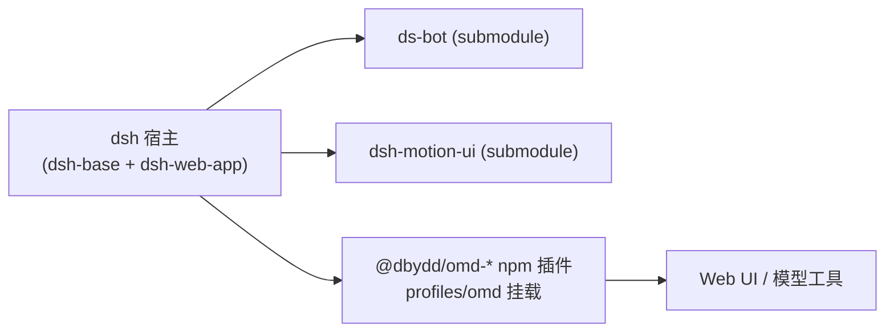

# oh-my-ds-bot

[dsh](https://github.com/dbydd/DS-Bot)（DeepSeek Harness）的树外插件套件与 profile 组合，把它配成日常主力 agent——**omd**。所有定制都在插件与 profile 层完成，上游与 `ds-bot` 应用检出保持原样。



## 快速开始

前置：`dsh` 0.2.1-rc.5（全局安装）、Node 22+/24、pnpm。

```sh
git clone --recurse-submodules https://github.com/dbydd/ohMyDsBot.git
cd ohMyDsBot
cd ds-bot/ds-bot && pnpm install --prod --ignore-scripts --lockfile=false --config.auto-install-peers=false && cd ../..
cd external-plugins/dsh-motion-ui && pnpm install --prod --ignore-scripts --lockfile=false --config.auto-install-peers=false && cd ../..
node plugins/link-host-runtime.mjs   # 把宿主运行时软链进插件模块根
```

安装 omd 组合（插件来自 npm）：

```sh
dsh plugin --profile omd add @dbydd/omd-internal-paths   # 或直接把 profiles/omd 复制到 $DSH_HOME/profiles/
dsh --profile omd --no-open                              # Web UI 默认 http://127.0.0.1:3080
```

模型网关不随仓库分发：`profiles/omd/cordis.patch.yml` 里判官候选与端点是占位值，按自己的判官端点改 `omd-judgment` 的 `candidates` 与 `endpoints`；不配则判官工具不注册，其余功能不受影响。

## 目录

| 路径 | 内容 |
|---|---|
| `plugins/` | 33 个 npm 插件（`@dbydd/omd-*`），另有 3 个不发布的 Onlyne 插件（`omd-onlyne`、`omd-compute`、`omd-issue-runner`）。目录见 [plugins/README.md](plugins/README.md) |
| `profiles/omd/` | 现役组合：`package.json`（依赖清单）+ `cordis.patch.yml`（挂载与配置） |
| `ds-bot/` | 只读 submodule，上游应用（DS-Bot v0.2.7 / dsh 0.2.1-rc.5） |
| `external-plugins/dsh-motion-ui/` | 只读 submodule，第三方交互组件（v0.8.9） |
| `docs/` | 设计说明与实施计划 |
| `design/` | Quint / VDM-SL / LikeC4 形式化模型 |
| `archived/` | Lean 验证实验与退役 profile（`archived/retired-profiles/`） |
| `scripts/` | `path`（内部路径 CLI）、`pack-desktop.mjs`（桌面包） |
| `profiles/omd-full/` | 日常桌面组合：钉死的 ds-bot + omd 插件。打包说明见 [docs/pack-desktop.md](docs/pack-desktop.md) |

## 开发

想自己写插件或改组合：插件加载、命名、注册与测试纪律见 [AGENTS.md](AGENTS.md)，各包的行为契约在包内 README 与 `docs/` 对应文档里。装本地改动用 `dsh plugin --profile omd add <插件目录>`，不必发 npm。

## 许可

GPL-3.0-or-later（见 [LICENSE](LICENSE)）。第三方引用的归属见 [NOTICE.md](NOTICE.md)。
