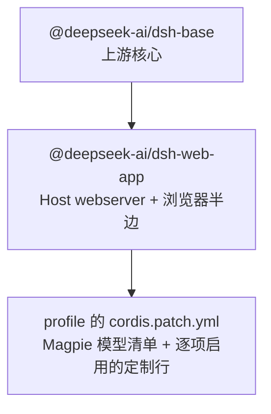

# omd 能力设计：宿主能力、耦合与 dsh 缺口

## 1. 目标与背景

`omd` 是这个仓库唯一的 profile：上游 `@deepseek-ai/dsh-base` 加 `@deepseek-ai/dsh-web-app`，宿主能力由本仓库自己的插件包提供。

- **能力住在宿主插件里。** 服务定义、状态模型、模型可见输入、持久化、工具实现都在能独立加载的插件包里；需要界面时，client 半边放进同一个包。
- **一次只开一项。** 定制按实际使用逐项挂载到 profile 的 patch，不整体启用 `omd-core`。没启用的插件保留源码、依赖与原来的组合文件。
- **上游不改造。** `refs/deepseek-harness/` 只读。

---

## 2. 组合拓扑

dsh 的 profile 是 `dsh.profile.bundles` 按顺序压平，再压上 profile 自己的 `cordis.patch.yml` 得到的 entry 树。

整层宿主组合保存在 `plugins/omd-core`，目前不在 `bundles` 里。恢复某项能力时，把它那一行从 `omd-core` 的 patch 搬到 profile 的 patch，而不是把整层挂回来。

### 组合规则
1. **模型配置不进 omd-core**：Magpie 网关把自己的模型清单写进 profile 自己的 `cordis.patch.yml`（`llm-pi-ai` 块加 `agent-default-model`），所以那段是**生成态**。`omd-core` 里不放任何模型行。网关只追加、不碰别人写的行，自己的行写在它下面就是安全的。

2. **能力行的正本是 omd-core**：`plugins/omd-core/cordis.patch.yml` 记录每种能力该用哪些包、什么顺序、什么配置。它是参考实现，不是当前组合；启用某一项时把对应的行复制到 profile 的 patch。

3. **装包与挂载分两步**：`dsh plugin --profile 
 add <dir>` 只把包变成 profile 的 `link:` 依赖，不会自动进 `bundles`（只有声明了 `dsh.bundle` 的包才会）。`omd-*` 插件都没有 `dsh.bundle`，所以它们的行写在 patch 里，而不是各自的 manifest 里。

4. **插件默认值机器无关**：网关地址、绝对路径、凭据、个人模型 id 只出现在 profile 的 patch 里。插件 `Config` 的默认值只表达"没配置时是什么状态"。

| Profile | `dsh.profile.bundles` 声明顺序 | 用途 |
|---|---|---|
| `omd` | `["@deepseek-ai/dsh-base", "@deepseek-ai/dsh-web-app"]` | 上游 Web 组合加逐项定制；`dsh --profile omd --no-open` 起服务 |

---

## 3. 承重不变量与移植纪律

根据上游架构审计与工程要求，任何移植到 `omd` 的能力必须遵守三条铁律：

1. **Model-visible ⟺ logged**：
   - 树外插件**无法声明新的持久化 session 事件类型**（上游 `known-event-types.ts` 是构建期闭合生成的，未知事件在读回历史时会触发 `SessionFormatUnsupportedError`）。
   - 因此，**所有进入模型上下文的新增输入**，必须通过已有合法通道：
     - 系统提示词注入：`ctx.systemPrompt.section({ name, order, text })`
     - 用户消息注入：`agent.inject(UserMessage)` → 触发标准的 `agent/inbox/spliced` 与 `user/message` 事件。
     - 工具执行结果：`output.render(args, value)` 投出纯文本块，自动落到 `tool/result`。
2. **注册即 effect**：
   - 所有工具、命令、投影单元的注册必须在 `apply` 中进行，且必须由 context 作用域接管（如 `ctx.tools.register(...)`、`ctx.sessionProjections.register(...)` 均返回 disposer）。
3. **加载顺序无关**：
   - 严禁在模块顶层或 `apply` 同步读取未在 `inject` 中声明的兄弟服务。

---

## 4. 第一批落地能力规划

---

## 4A. 功能之间的耦合：omp 真正难复制的部分

复刻单个工具的功能是不够的。omp 的价值有很大一部分在**工具之间的耦合设计**，以及**替模型擦屁股的机制**。这些必须作为一等公民写进 omd-core 的设计，而不是等单个包做完再补。

### 4A.1 十条耦合设计（按移植优先级）

| # | 耦合 | 机制 | 无它时的失效模式 |
||---|---|---|---|
| 1 | `edit`/`write` → LSP 诊断回灌 | 写完立刻拿到诊断，慢 server 走延迟通道，迟到结果以 `<system-notice>` 注入下一轮；新鲜度用编辑前 `minVersions` 基线判定，不是猜 | 模型改完不知道有没有改坏，要另起一轮 typecheck |
| 2 | 结构化搜索/改写 → 暂存预览 | ast_grep/ast_edit 的改动先暂存，由用户放行才落盘；接受时对当前工作树**重跑**匹配，而不是重放旧字节 | 预览与实际落盘不一致；过宽的匹配静默改坏仓库 |
| 3 | `checkpoint`/`rewind` → 会话分支 | 检查点把探索段从活动上下文切掉，只留报告；不是 git 快照，是分支截断 | 探索历史把上下文撑爆，且无法回退 |
| 4 | `context_notes` → 系统提示 | 16 KiB 便签非空时注入系统提示；模型自己维护它 | 长任务中早期决策丢失，compaction 后失忆 |
| 5 | compaction 五级回退链 | `remote → snapcompact → handoff → shake → soft`，任一不可用自动降级，不卡死 | 单一 compaction 失败 = 会话卡死 |
| 6 | advisor emission guard | 准入边界丢四类：`empty` / `noise`（固定无信息量短语表）/ `duplicate`（大小写标点折叠去重，要求更高 severity 才放行）/ `rate-limit`（默认每轮 4 条非 blocker，硬顶 32） | 主 transcript 被刷屏：一次会话 309 次 advise 覆盖 92 条唯一建议 |
| 7 | 工具结果逐条淘汰 + `useless` 标记 | 空查询打 `useless: true` 供压缩时丢弃；**干净的 diagnostics 不打**——它是验证证据 | token 浪费，且把证据和噪音一起删了 |
| 8 | prewalk 一次性交接 | 强模型建好 todo 并完成首次编辑 → 切到快模型；`Nothing to switch` 时主动 disarm | 要么全程贵模型烧钱，要么全程弱模型做坏 |
| 9 | plan mode 的工具表冻结 | 工具目录跨模式保持一致（request-cache 稳定），plan 规则覆盖工具描述 | 切模式导致请求形状变化，prompt cache 全废 |
| 10 | subagent 上下文不继承 | 子会话只拿 brief 和相关共享上下文，看不到父会话转录；fork 子会话保持 provider/model 一致以复用 KV cache | 上下文泄漏 + 缓存失效 |

### 4A.2 三条"擦屁股"机制（omp 的隐藏护城河）

**TTSR（Time-Traveling Stream Rules）**——在模型**正在生成**的时候识别可预见的错误，中断、注入规则正文、重新生成。这比事后拦截强一个量级：错误在工具调用执行前就被拦下了。

- 匹配面：`text`（散文）/ `thinking` / `tool:<name>(<glob>)`
- 触发条件：JS 正则 `condition` 或 ast-grep 模式 `astCondition`，二者任一命中即可
- 中断粒度：`always` / `prose-only` / `tool-only` / `never`
- `contextMode: discard` 丢弃部分响应再重试，比 `keep` 安全
- 默认每条规则每会话只触发一次，`after-gap` 允许冷却后再次触发
- **dsh 侧映射（已落地）**：`ctx.on('llm/stream', …, { global: true, prepend: true })` 才是流式接缝；`tools/pre-execute` 只在工具调用已成形后触发。已实现为 `omd-ttsr`，代价与取舍见 §6.1

**`useless` 标记与工具结果淘汰**——不是所有工具结果都值得留在上下文里。空搜索结果、超时等待、已消费的输出，打上标记让 compaction 删掉；而**验证证据**（干净的 diagnostics、测试通过）必须留。

**advisor 去重与限额**——见上表 #6。核心洞察：**建议的价值与数量成反比**，没有 guard 的 advisor 是负资产。

### 4.1 omd-core 宿主包骨架
- 路径：`plugins/omd-core/`
- 产物：`cordis.patch.yml`，单个 `insert` 块列出全部能力行，加上 `omd-web-providers` 与 `web` 行的 provider 配置。没有任何模型行。
- 包本身没有运行时 API：`src/index.ts` 只 `export {}`，`package.json` 用 `dsh.bundle.patch` 指向那份 patch。
- MCP **不裸挂载**：`@deepseek-ai/dsh-mcp-client` 的 config 是 per-server 联合，`apply` 读 `config.reconnect`，无 config 的行会在启动时抛错。一个 server 一行，带 `transport` / `serverName` 与 `url` 或 `command`；注释里写了范例。

### 4.3 omd-context-notes（工作记忆便签）
- 对应 omp 的 `context_notes` (16 KiB) 与 `new_context` 信号。
- 宿主能力：
  - 注册 `context_notes` 工具（参数 `text` + `action: read|write|clear`，省略 `action` 时按有没有 `text` 推断）。
  - 工具通过 `output.presentationMeta` 投出 `{ contextNotes: { text, bytes, version } }`，这是便签落日志的**唯一**通道：树外插件不能新增 session 事件类型，而 `presentationMeta` 会随 `tool/result` 事件一起写进日志。
  - 注册 `contextNotes` 投影（`stateVersion: 1`）折叠那些 `tool/result`，用整篇替换、不是追加；无关事件返回同一引用。
  - 注入 `systemPrompt.section`（`omd:context-notes`，order 85），文本在每次组装时从投影读取，空便签返回 `''`。
- 纯宿主无界面依赖；**不提供** `wire` 视图，因为它没有客户端消费者（界面如果需要，读投影即可）。

### 4.4 检查点能力（omd-checkpoint）
- 对应 omp 的 `checkpoint` 与 `rewind`。
- 结论：**用社区 `dsh-rewind-plugin@0.17.1`，不自写**。依赖已经在 profile 的 manifest 里，恢复时加一行 `dsh-rewind-plugin` 即可，快照落在 `$DSH_HOME/rewind-snapshots`。
- omp 的「检查点把探索段从上下文切掉、只留报告」是**分支截断**语义，与 rewind 的快照回滚不是同一件事；需要切上下文时用 `omd-handoff` 生成交接文档，而不是靠检查点。

---

## 5. dsh 现状与缺口对照

### 5.1 dsh 已有、不必移植

| omp 能力 | dsh 等价物 | 位置 |
|---|---|---|
| session 持久化 + 崩溃恢复 | `session-persistence-jsonl` + `core/session/src/repair.ts`（`TOOL_NOT_STARTED` / `TOOL_OUTCOME_UNKNOWN`，在 `step/end` 前补齐） | 上游 |
| 上下文压缩 | `compaction-basic` + `tool-result-pruner` + `image-offload` | 上游 |
| 会话分支 / 树 | `session-projection` + `subagent` 的 catalog 谱系 | 上游 |
| 计划模式 | `plan-mode`（`section` 配置 + `exit_plan_mode` 工具 + `plan` 投影） | 上游 |
| 目标模式 | `goal` + `goal-round-driver` + `tool-goal` | 上游 |
| todo 清单 | `tool-todo`（含 `allowParallelInProgress`）+ `todos` 投影 | 上游 |
| 审批 / 沙箱 | `sandbox-policy` + `user-approval` + `permission-presets`（三档预设） | 上游 |
| 子代理派发 | `subagent` + spawn/fork provider + `tool-subagent` / `tool-subagent-control` | 上游 |
| skills | `skill` + `skill-filesystem` + `tool-skill` | 上游 |
| 斜杠命令 | `commands` + `command-feedback`（自动落 `command/run` / `command/done`） | 上游 |
| 用户提问 | `user-questions` + `ask_user_question` 工具 | 上游 |
| MCP | `mcp-resources` + `mcp-client` | 上游 |
| 文件工具 | `tool-fs`（read/write/edit/read-image）+ `fs-observation-policy` | 上游 |
| 搜索工具 | `tool-fs-search`（glob/grep） | 上游 |
| shell | `tool-bash` + `bash-sandbox` + `subprocess-local` | 上游 |
| 溢出保护 | `spill-policy`（`maxInlineTokens`）+ `spill-local` | 上游 |
| 工具超时 | `tool-call-timeout-policy` | 上游 |
| 模型路由 | `llm` + `llm-pi-ai`（多 provider 并列，具名路由表）+ `agent-default-model` | 上游 |
| 凭据管理 | `authorization` + `credentials-local`（`apiKeyEnv` 引用，按请求解析） | 上游 |
| 遥测（可关） | `session-telemetry-otel`（`DSH_TELEMETRY_DISABLED` 任意非空值即关） | 上游 |
| worktree 隔离任务 | `experimental-worktree` + `experimental-tool-worktree` | 上游 experimental |
| 交互式终端 | `terminal` + `terminal-bash` + `tool-terminal` | 上游 |
| 会话检索 | `experimental-session-search` | 上游 experimental |
| 自动审查 | `experimental-auto-review` | 上游 experimental |
| 代理团队 | `experimental-agent-team` + `experimental-tool-agent-team` | 上游 experimental |
| HTML 导出 | `session-log-export`（web 层） | 上游 |
| 用量统计 | `session-stats` 投影 + `session-turn-outline` | 上游 |
| 变更文件卡片 | `workspace-changes`（git 工作树快照） | 上游 |

### 5.2 落地的能力与选型

优先级判据：**先看现成包能不能直接用，能改改就用的绝不自己写**。下表的「方案」列就是最终决定，不是候选。

| omp 能力 | 方案 | 落点 |
|---|---|---|
| LSP 代码智能 | 社区 `dsh-tool-lsp` 提供 server 与五个工具；缺的导航族由 `omd-lsp-nav` 补齐 | `lsp` + `omd-lsp-nav` |
| LSP 诊断回灌 | **自己写** `omd-lsp-writethrough`：`tools/post-execute` 改写 `edit`/`write` 的结果 | `omd-lsp-writethrough` |
| AST 结构化搜索 | 社区 `dsh-tool-ast-grep`（只搜不改） | `tool-ast-grep` |
| AST 两阶段改写 | **自己写** `omd-ast-edit`：`ast_edit` 暂存、`ast_apply` 重跑匹配后提交 | `omd-ast-edit` |
| checkpoint / rewind | 社区 `dsh-rewind-plugin@0.17.1` | `dsh-rewind-plugin` |
| context_notes | **自己写** `omd-context-notes`（`presentationMeta` + 投影；见 §4.3） | `omd-context-notes` |
| 判官 / decision model | **自己写** `omd-judgment`：原生 System One + chat 回退 + 缓存 + 拒绝冷却 | `omd-judgment` |
| 任务难度分级 | **自己写** `omd-auto-thinking`，消费 `ctx.judgment` | `omd-auto-thinking` |
| 意外停止判定 | **自己写** `omd-unexpected-stop`（mechanical 正则，smart 追加判官） | `omd-unexpected-stop` |
| advisor + emission guard | **自己写** `omd-advisor`：四重守卫 + immuneTurns 降级 | `omd-advisor` |
| handoff | **自己写** `omd-handoff`：四节模板 + `handoff` 投影 | `omd-handoff` |
| 结果淘汰 + 证据保留 | **自己写** `omd-tool-eviction` | `omd-tool-eviction` |
| 无摘要瘦身 | **自己写** `omd-shake`（surface replacement，见 §6） | `omd-shake` |
| plan 模式工具表冻结 | **自己写** `omd-plan-gate`：提示段冻结 + `exit_plan_with` 三选一 | `omd-plan-gate` |
| `/loop` | **自己写** `omd-loop` | `omd-loop` |
| `/force` | **自己写** `omd-force` | `omd-force` |
| prewalk 一次性交接 | **自己写** `omd-prewalk` | `omd-prewalk` |
| TTSR 流式规则 | **自己写** `omd-ttsr`（见 §6 的缓冲决定） | `omd-ttsr` |
| agent 目录 | **自己写** `omd-agents`（frontmatter → `ctx.agentCatalog`） | `omd-agents` |
| batch 派发 | **自己写** `omd-task`（自有 semaphore 排队） | `omd-task` |
| 子代理 worktree | **自己写** `omd-worktree-alloc`（上游 `create` 会改调用者 cwd，不能直接用） | `omd-worktree-alloc` |
| 子代理观测 | **自己写** `omd-agents-hub`（`omdAgents` 投影） | `omd-agents-hub` |
| 浏览器自动化 | 社区 `dsh-browser-tool@0.1.11`（peer 覆盖 `0.2.1-rc.2`） | `dsh-browser-tool` |
| 多厂商搜索抓取回退 | **已有** `omd-web-providers` | `omd-web-providers` |
| 密钥泄漏防护 | 社区 `dsh-secret-scan` | 未挂载，留待下一版 |
| 调试器（DAP） | 无现成包 | 不做 |
| eval 内核 | 上游 `ptc-runtime-node`（JS）；Python 无会话内核 | 不做，见 §6 |

### 5.3 装包时的四个已知障碍

1. **`pnpm` 12 拒绝带未批准构建脚本的安装**：报 `ERR_PNPM_IGNORED_BUILDS`，指针是 `sharp@0.33.5`（`dsh-browser-tool` 的依赖）。
   - **解法**：`cd $DSH_HOME/profiles/
 && pnpm approve-builds sharp`。它会把批准写进该 profile 的 `pnpm-workspace.yaml`（`allowBuilds: { sharp: true }`），之后 `dsh plugin add` 才放行。**`onlyBuiltDependencies` 这个旧键在 12 里不生效。**

2. **`remove` 会重新解析整份 lockfile**：某个带未发布传递依赖的包（本机实测 `@deepseek-ai/dsh-type-meta` 404）会让 `dsh plugin --profile omd remove …` 直接失败，而同一 profile 的 `add` 却成功。
   - **解法**：先做完全部需要的 `add`，再 `remove`；安装动作会先刷新 lockfile，之后 `remove` 就不再需要联网解析那条缺失项。

3. **peer 版本门禁会静默禁用行**：dsh 启动时校验每个插件的 `peerDependencies` 是否覆盖运行时的 `0.2.1-rc.2`。不覆盖就打印 `dsh: disabling profile plugin row "<id>"` 并禁用该行。
   - `dsh-browser-playwright@0.1.1` 声明 `@deepseek-ai/dsh-llm: ">=0.1.0-rc.2 <0.1.0-rc.7"`，**不含** `0.2.1-rc.2`，三行全部被禁。
   - **已采用**：换成 `dsh-browser-tool@0.1.11`（peer `^0.2.1-rc.2`），并把 `dsh-browser-playwright` 从当时的三个 profile 里删掉。

4. **`pnpm` 12 不再读 `package.json` 的 `pnpm.overrides`**：带版本钉表的 profile manifest（曾经是已退役的 `omdt`）会被忽略并告警。当前 lockfile 已固定解析结果，所以不影响运行；要真正钉版本，得把它搬进 `pnpm-workspace.yaml`。

---

## 6. 已解决的决定，与仍然开着的口子

标题里的每一项都记下当时的疑问与最终答案。§6.6 记录的是终端界面的遗留问题，随终端方向一起作废。

1. **TTSR 已落地为流式 + 原生 retry，零缓冲**。`ctx.on('llm/stream', …, { global: true, prepend: true })` 拦截 `llm/stream` 全局 waterfall；实现把上游 chunk 实时透传（`yield chunk`），逐片累积文本并测试规则。命中时**立即停止上游迭代器**（`iterator.return?.()`），合成一条 `finish { reason: { kind: 'error', code: 'OMD_TTSR_TRIGGERED' } }`，把当前尝试作为 `assistant/attempt` 结算（不进 `deriveMessages()`）。随后水落 `agent/request-error`，处理器追加 `user/message { source: 'omd-ttsr', rule }` 并返回 `{ kind: 'retry' }`。agent loop 走正常的重试路径：从会话日志重建请求，规则正文已作为持久 `user/message` 在上下文里。整个过程**零缓冲**——用户仍看到逐字符打字；命中的那段前缀会短暂闪现再被重试结果替换，这是流式的固有代价。规则是 opt-in，没有规则时直通且零开销。

2. **`useless` 落点已定**：`tool-result-pruner` 不读 `presentationMeta`，所以不能指望它区分「空查询」与「验证证据」。`omd-tool-eviction` 改在 `tools/post-execute` 里就地处理：`!isError` 且（`trim().length <= 1` ∨ 以 `No matches` / `No files` / `Nothing to` / `(empty)` 开头 ∨ `meta.useless === true`）就整块替换成 `(evicted: empty result)`；`bash` 且含 `passed` / `PASS` / `ok` 的结果逐字节不动，只写进 `omdToolEvidence` 投影。这样淘汰发生在截断之前，证据不会被误吃。

3. **诊断回灌的延迟通道已确定**：`agent.inject(UserMessage)`，在下一个 `agent/pre-step` 里投递。`omd-lsp-writethrough` 的慢路径把请求丢进 12 秒上限的队列，队列在 `pre-step` drain；延迟期间同一文件被再次编辑就丢弃旧结果。

4. **client 半边的加载由 `dsh-client-modules` 决定**：它随 `dsh-web-app` 挂载，只认 `dsh.client.platform === 'web'`。因此声明了 client 半边的包必须带 `./client`，缺了在 `omd` 里启动即失败（`MissingClientBundleError`）；不声明 `dsh.client` 的包是纯宿主，任何组合都能挂。

5. **`defineTool` 与 `z<Config>` 的写法已校准**：`defineTool` 的泛型参数接的是 schema spec，**不能**写成 `defineTool<Args, Result>`；`Config` 用 `import z from '@deepseek-ai/schemastery'`（默认导入）配 `export const Config: z<Config>`。`omd-context-notes` 早期版本两处都写错，已在重写中修正并经真实回合验证。

6. **终端界面的绘制接缝**（已作废）：这一条描述的是 TUI 渲染器的语义节点缺口，随终端方向放弃，不再跟进。
