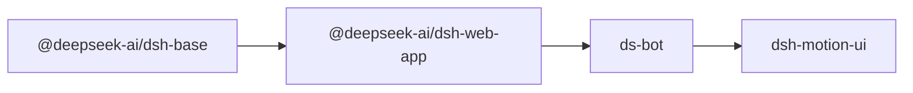

# Out-of-tree dsh plugins

This directory holds our out-of-tree extensions. Current development targets DS-Bot v0.2.7 on dsh 0.2.1-rc.5. The read-only application checkout lives at `../ds-bot/`; the dsh source under `../refs/deepseek-harness/` is an older rc.2 reference. Changes belong in local plugins and profile overlays.

Every package in the table below publishes to npm as `@dbydd/<name>` (the table uses the unscoped shorthand). The Onlyne packages under [The Onlyne suite](#the-onlyne-suite) are private and keep their unscoped names. Host runtime packages (`@deepseek-ai/*`) stay in `peerDependencies` + `devDependencies`; the dsh host provides them.

The existing `omd` profile retains its custom composition. The new DS-Bot composition starts with the following bundle order:



`archived/` holds 18 unused packages. The table below includes historical packages; an archived package's source is under `archived/<name>/`. Mounted packages and imported helpers remain in this directory. A dependency declaration alone does not mean a package is mounted. Magpie provider configuration remains in each profile's patch.

## Packages

| package | what it is |
|---|---|
| `omd-core` | The bundle itself. Its substance is `cordis.patch.yml`, declared by `dsh.bundle.patch`; the package has no runtime API. |
| `omd-web-providers` | Search and fetch failover chain behind the `web` row's `searchProvider` / `fetchProvider`. |
| `omd-context-notes` | 16 KiB working-memory notebook. The tool writes it, a session projection folds it, and a prompt section renders it — module state never holds it. |
| `omd-skill-catalog` | The session skill catalog, published here instead of upstream `dsh-tool-skill`, with the `skill` tool denied so `read skill://<name>` is the only load path. Denies only where its own catalog can take over; otherwise upstream's stays authoritative. |
| `omd-roles` | Named model roles resolved to routes behind `ctx.modelRoles`. One role call is one single-turn model call, optionally constrained by a JSON schema; `omd-judgment` takes its route from the `judge` role when this package is mounted. |
| `omd-judgment` | The decision model. The `judge` role when `omd-roles` is mounted; otherwise native TypeSafe System One first and a chat fallback second. One `ctx.judgment` service with result caching and account-rejection cooldown. |
| `omd-auto-thinking` | Per-step reasoning effort chosen from the user request through `ctx.judgment`. |
| `omd-unexpected-stop` | Detects a reply that announces a next step and then stops, and pushes the agent back to work. |
| `omd-advisor` | Review-model advisories admitted through omp's four-rule emission guard, with an immune window after an interruption. |
| `omd-handoff` | `/handoff` — one LLM call over the recorded todo and goal projections, producing a four-section continuation document. |
| `omd-tool-eviction` | Rewrites uninformative tool results to `(evicted: empty result)` while recording which results carried evidence (test passes, build success). |
| `omd-shake` | `/shake [elide\|images\|thinking]` — trims recoverable content from history without spending a model call. |
| `omd-lsp-nav` | The five navigation tools the community client lacks: definition, type definition, implementation, references, hover. |
| `omd-lsp-writethrough` | Returns new diagnostics inside the `edit`/`write` result, with a deferred queue for language servers slower than the 2 s budget. |
| `omd-ast-edit` | `ast_edit` stages matches, `ast_apply` re-runs them against the current tree and commits only what still matches. |
| `omd-plan-gate` | Keeps the tool catalog frozen across plan mode and adds a three-way plan exit (`execute` / `compact` / `keep`). |
| `omd-loop` | `/loop` — repeats one prompt until an iteration or time budget runs out. |
| `omd-force` | `/force <tool>` — the next turn's first tool call must be the named one. |
| `omd-prewalk` | One-shot handoff to a cheaper model after the first successful `edit`/`write`. |
| `omd-ttsr` | Streaming stop-and-retry rules: a matching rule abandons the attempt and reissues it with the rule body in the system prompt. |
| `omd-agents` | Markdown agent definitions, a prompt catalog, and the `ctx.agentCatalog` service. |
| `omd-task` | Batch subagent delegation: one call fans out to many children, queued rather than refused at the activation ceiling. |
| `omd-worktree-alloc` | Copy-on-write working copies for children, with the change set read back as a patch, without ever moving the caller's working directory. |
| `omd-agents-hub` | Durable subagent roster as the `omdAgents` projection, so a restarted session can still describe its workers. |
| `omd-table-chart` | The first table of a settled answer becomes a chart record (`plugin:omd/table-chart`) and an inline SVG in the chat row; `omd-chart-plan` does the reading and the kind cascade. |
| `omd-hindsight` | Sealed. Its package is kept for reference and is loaded by no profile. |

## The Onlyne suite

`omd-onlyne`, `omd-compute`, and `omd-issue-runner` live in this directory.
They are `private: true`, keep the unscoped package names, and are not published
to npm. Each is a `link:` dependency of a dsh profile. Mount one by adding the
row in its `cordis.patch.yml`, or with `dsh plugin --profile <profile> add
./plugins/<name>` — each declares `dsh.bundle`. They are not part of
`profiles/omd`'s npm composition. `archived/onlyne-bridge` is not in this
repository.

| package | what it is |
|---|---|
| `omd-onlyne/` | Onlyne v3 for one DSH process: stable node identity shared across sessions over one process HTTP listener, durable SQLite/file storage, on-demand single-flight pairing, configured remote seeds, the `msg` tool, `onlyne://` (`directory`, `neighbors`, `threads`, `inbox`, `runner/workers`), and `ctx.onlyne`. |
| `omd-compute/` | OECP v1 compute leases over OrbStack machines — `acquire`, `renew`, `release`, `destroy`, `status` — with single-owner enforcement (`forbidden`), hard `maxTtlMs` (`capacity_exceeded`), full connection/allocation receipts, and expiry notices. |
| `omd-issue-runner/` | Issue-driven coding: an Onlyne participant with first-class `meta.work` idempotency, decoupled worker URIs (`onlyne://runner/issue/<workerId>`) and `onlyne://runner/workers` catalog, cross-thread `review` (`approve`/`reject`), and automatic `ttl/2` lease heartbeats. |

They import each other, `omd-internal-paths`, and `omd-sandbox-vm` by package
specifier. `node plugins/link-host-runtime.mjs` links those names into
`plugins/node_modules`, together with the host runtime. `@onlyne/lib` is not in
this repository: the same script links it from `$ONLYNE_ROOT/packages/lib` when
an Onlyne checkout is present (`ONLYNE_ROOT` defaults to
`~/Documents/progs/onlyne`). A missing checkout skips only that specifier.

```sh
node plugins/link-host-runtime.mjs
dsh plugin --profile <profile> add ./plugins/omd-onlyne
dsh plugin --profile <profile> add ./plugins/omd-compute
dsh plugin --profile <profile> add ./plugins/omd-issue-runner
bun test omd-onlyne omd-compute omd-issue-runner   # from plugins/
```

## Which half goes where

A capability ships as one package. Ask whether it works with no screen attached; if it does not, the browser half goes in the same package as `src/client/` plus `dsh.client: { platform: 'web' }`, not in a second package.

1. The client half never imports `node:` builtins; the host half never imports the client half.
2. The host half is finished and usable before the client half exists. The client half owns no state, writes no session events, and produces no model-visible input.
3. One package per capability. There is no `-ui` suffix convention: a package that needs a browser half carries both halves.

## Session state without new event types

`packages/core/session/src/known-event-types.ts` is generated from the `SessionEventMap` declarations in the harness repository, and the persistence read path refuses a log carrying a type outside that set. A plugin-declared event type is outside the vocabulary by construction, and a session written with one does not reopen.

So nothing here invents an event type. Durable state uses the two channels that already survive a restart:

- **`presentationMeta` on a tool result.** The agent loop writes it onto the `tool/result` event it already logs, and a `ctx.sessionProjections` unit folds those records. `omd-context-notes` stores its notebook this way.
- **Folding events the harness already commits.** `omd-agents-hub` reads `subagent/catalog`, `tool-workflow/agent-start`/`agent-end`, and settlement notices; `omd-handoff` reads the `todos` and `goal` projections.

State that no existing event can carry lives in process memory and says so in its package JSDoc. `omd-ttsr`'s fired-rule set is the clearest case: a restart forgets it, and a rule may fire once more.

## Install and link

`dsh plugin --profile <name> add <dir>` installs a local directory as a `link:` dependency of the profile. Node resolves the plugin's *own* bare imports from its real path under this repository, which never reaches `$DSH_HOME/profiles/node_modules` — the layer the profile itself resolves against. `link-host-runtime.mjs` closes that gap with symlinks into that layer, so the plugin ends up holding the very same module instance the host holds rather than a second copy whose module-level symbols would not match:

```sh
node plugins/link-host-runtime.mjs                 # host packages from the interception layer
node plugins/link-host-runtime.mjs --from-profile omd
```

The second list matters for `omd-lsp-nav` and `omd-ast-edit`: they import `dsh-tool-lsp` / `dsh-tool-ast-grep` internals, which a *profile* installs rather than the shared layer. The in-tree list exists for the same reason: `omd-todo-driver` imports `omd-todo` and `omd-judge-context` by package name, and neither is a profile dependency. The Onlyne packages are on that list too: `omd-compute` and `omd-issue-runner` import `omd-onlyne`, `omd-internal-paths`, and `omd-sandbox-vm` by package specifier.

`pnpm` 12 refuses an install with unapproved build scripts. `dsh-browser-tool` depends on `sharp`, so each profile that installs it needs the approval recorded once:

```sh
cd "$DSH_HOME/profiles/<name>" && pnpm approve-builds sharp
```

## Load

`$DSH_HOME/profiles/<name>/cordis.patch.yml` is a YAML array of patch entries. An **empty** layer must be spelled `[]` — a comment-only file fails to parse.

```yaml
- insert:
    - id: omd-context-notes
      name: omd-context-notes
```

`name` accepts a bare package name, an absolute path, or a file URL, and must resolve to a **file**: a directory is `ERR_UNSUPPORTED_DIR_IMPORT`, because Node's ESM resolver does no `package.json` fallback. A bare name goes through the package's `exports["."]`, which these packages point at `./src/index.ts` — the Loader imports TypeScript source directly on any Node that strips types, so the host halves need no build step.

Two mistakes cost a boot each, both documented in the patch header:

- **Mounting `@deepseek-ai/dsh-mcp-client` bare.** Its config is a per-server union and `apply` reads `config.reconnect`, so a row without a config crashes the boot. One server is one row carrying `transport`, `serverName`, and `url` or `command`.
- **Writing a comment-only patch layer.** The composer parses the file as a YAML array; a file with no entries fails before any plugin loads.

A plugin that throws in `apply` is **not** fatal: the boot prints `N entries did not activate` with that entry's own stack and keeps serving. When a plugin "silently does nothing", read the boot output for that warning — `omd` has no console logger, so `ctx.logger` writes go nowhere.

## Previous checks of the saved plugins

These checks describe the earlier composition. They do not indicate that a plugin is currently enabled.

| claim | evidence |
|---|---|
| The host layer boots clean | `dsh --profile omd` reports no `entries did not activate` and no `disabling profile plugin row`. |
| The judge reaches the real gateway | `dsh --profile omdh "Call the judge tool …"` returned `Value: 0.0093`, a calibrated `noul` from `POST /v1/systemone` (the gateway answered as `clef-flash`). |
| The notebook is projection-backed and prompt-visible | In one headless turn: write → `Context notes updated (17 bytes).`; read → the exact notebook text; the system prompt reported `Latest notebook revision (17 bytes): - probe: one line`. |
| Empty results are evicted before truncation | The same turn ran a `grep` with no matches and received exactly `(evicted: empty result)`. |
| The single profile composes and serves | `dsh --profile omd --dump-config` exits 0 with 2,077 composed lines and no stderr; `agent-default-model` is patched by the profile's own file, while `web`, `webserver`, `ui-settings-general`, and every `omd-*` row come from the bundle layers. `dsh --profile omd --no-open --port 0` boots with no `entries did not activate` and answers `401` at `/` without the token. |

Static type-checking of these packages is **not** a gate here. Per-package `tsc` runs against the published `@deepseek-ai/cordis` typings, which omit the `ctx.provide` / `ctx.effect` members the runtime actually exposes, and against duplicate `zod` copies that make structural comparison fail. The check that counts is booting the profile and driving a real turn.
