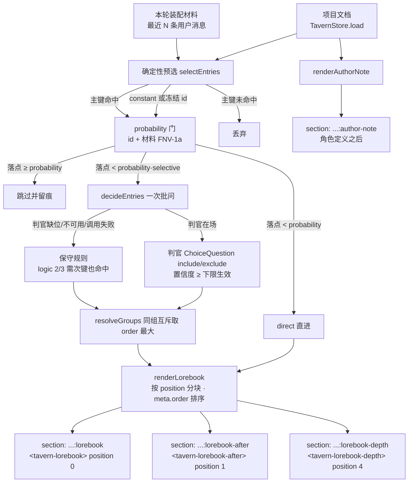

# omd-tavern-assemble

酒馆装配器（宿主半边）：把 `omd-context-tavern` 的项目文档真正送进模型请求。`omd-context-tavern` 负责存（世界书、Author's Note、纪元），本插件负责选与拼：每轮装配读一次项目文档，跑确定性预选与概率门，悬置条目交判官一次批问，最后按 `meta.position` 渲染成三个世界书区块加一个 Author's Note。

## 装配顺序

四个 section 都在 `apply` 时静态注册，文本由每个 agent 的 `system-prompt/assemble` waterfall 现算（判官调用是异步的，`PromptSection.text` provider 不能 await），空文本对装配无贡献。顺序值来自注册表锚点：`lorebook` 在 `PLAN_POLICY - 1`，`lorebook-after` 在 `DEPLOYMENT_PERSONA_SUFFIX + 1`，`author-note` 在 `+2`，`lorebook-depth` 在 `+3`。

## 判官批问协议

一次 `ctx.judgment.judge` 带全部悬置条目：每条一个 `choice` 问题，labels `include` / `exclude`。state 携带条目名、主键、次键、`selectiveLogic` 的 SillyTavern 语义说明、次键是否出现在最近对话、分组关系与互斥说明、最近对话摘要；条目正文不进 state。判官是推理同伴，题目解释「为什么判、include/exclude 各意味着什么」，不列裸规则。

- `include` 且置信度 ≥ `confidenceFloor`（默认 0.4）→ 注入；
- `include` 但置信度低于下限 → 按 exclude 处理并 warn；
- 答案缺失或形状不对 → exclude 并 warn；
- 判官调用抛错 → 全批走保守规则并 warn。

每条判定都留痕：`ctx.logger.info/warn` 一行（谁、命中与否、置信度、走了哪条路）。

## 降级规则（无判官）

`ctx.get('judgment') === undefined`、`available() === false` 或调用失败时，悬置条目由保守规则决定，装配不崩：

- `selectiveLogic` 为 **0 (AND_ANY) / 1 (NOT_ALL)**：主键命中即注入；
- `selectiveLogic` 为 **2 (NOT_ANY)**：主键命中且**没有**任何次键出现在材料中才注入；
- `selectiveLogic` 为 **3 (AND_ALL)**：主键命中且**全部**次键出现在材料中才注入。

无键条目：非 selective 永不进；selective 的无键条目只有判官在场才可能被问及。

## 预选规则

1. `constant === true` 或 id 在 `frozenEntryIds` → 直进前缀（纪元换届逻辑归 `omd-context-tavern`，本插件只认结果）；
2. 其余条目：`keys` 任一主键出现在「本轮装配材料」（最近 `recentUserMessages` 条用户消息文本，默认 4）→ 候选；
3. 无主键且无 `meta.selective` → 不进；
4. `meta.selective === true` 且有 `secondaryKeys` → 交判官（或保守规则）；
5. 同 `meta.group` 互斥：被判官 include 的条目里取 `meta.order` 最大者。

概率门插在第 1、2 条与第 4 条之间：任何候选（含 `constant` 与冻结条目）在进 direct 或进判官队列之前先过门，所以判官的答案不可能把被门挡下的条目捞回来。

## Token 上限

估算器复用 `omd-judge-context` 的 `estimateTokens`（ASCII 4 字符/token，其余每码点 1）：

- 单条正文超过 `singleEntryMaxTokens`（默认 1500）→ 原位截断并 warn；
- 三个世界书区块共用 `maxPrefixTokens`（默认 8000）这一个总量，按 prompt 顺序（prefix → after → depth）依次填充，超出后剩下的条目整条跳过并 warn。

## probability / position / depth

`probability`（0–100）是确定性门，不掷骰：把条目 id 与本轮装配材料拼起来做 FNV-1a，映射到 `[0, 100)` 得到一个落点，落点小于 `probability` 才放行。同一份文档、同一段最近消息 → 同一结论，会话推进才会换落点。`100` 恒放行、`0` 恒挡下、缺省按 `100`。被挡下的条目每次装配留一行 `info`：「probability N 未命中落点 x.xx，跳过」。

`position` 决定条目进哪个区块：

| 值 | SillyTavern 语义 | 本实现的落点 |
| --- | --- | --- |
| `0` / `before_char` / 缺省 | 角色定义之前 | `omd-tavern-assemble:lorebook`，`PLAN_POLICY - 1` |
| `1` / `after_char` | 角色定义之后 | `omd-tavern-assemble:lorebook-after`，`DEPLOYMENT_PERSONA_SUFFIX + 1` |
| `4` | 对话尾部按深度注入 | `omd-tavern-assemble:lorebook-depth`，`DEPLOYMENT_PERSONA_SUFFIX + 3` |
| `2` / `3` | Author's Note 上/下方 | 没有对应的插入点（本仓库的 note 是单段），回落到 `0` |

注册表只能往 system prompt 里放段，不能把文本插进对话消息之间，所以 `4` 的诚实落点是「紧贴尾部的段落」：区块首行写明这些设定附着在对话尾部，以及各自的深度窗口。要真正插到消息之间，得换一条注入通路，不在本插件的能力范围内。

`depth` 是 position 4 条目的附着窗口：默认 `4`（SillyTavern 的缺省），按会话当前消息数（`user/message` + `assistant/message`）收敛。历史比 `depth` 短时取实际条数，并 warn 一行「depth N 超过可用历史 M 条消息，已收敛为 M」。

仍未解释的字段：`sticky`、`cooldown`、`delay`、`groupWeight`、`useGroupScoring`、`role`、`caseSensitive`、`matchWholeWords`。它们按原值保存在 `meta`，装配不读。

## 配置

| 字段 | 默认 | 含义 |
| --- | --- | --- |
| `enabled` | `true` | 总开关；关掉则不注册任何 section |
| `recentUserMessages` | `4` | 主键匹配的最近用户消息窗口 |
| `confidenceFloor` | `0.4` | 判官 include 的置信度下限 |
| `maxPrefixTokens` | `8000` | 世界书 section 总量上限 |
| `singleEntryMaxTokens` | `1500` | 单条正文上限 |

cwd 从 `context.agent.session.header?.cwd` 解析；没有 cwd 的会话整个装配返回空，section 不出现。`inject: ['systemPrompt']`；`judgment` 按轮读 `ctx.get`，缺位走降级而非挂载失败。

## 验证

- `tsc --noEmit -p tsconfig.json` 零诊断；
- 一次性脚本断言 16 条：probability 0/100/中值跨材料、门在两次同输入下不变、中值两侧都出现、门挡下的条目不进 direct/judged、判官全 include 也捞不回来、position 0/1/4 与字符串形式的分块、section 顺序、position 4 独立成块、depth 缺省/不收敛/短历史收敛并 warn；
- 纯函数断言（mock 判官）：constant 直进、主键命中、四类 selectiveLogic 保守规则、批问/降级/低置信/坏答案、分组互斥、排序、截断与预算；
- 真实判官一轮（magpie `group/decider` System One）：4 条悬置条目各得 include/exclude 与置信度，section 文本与判定一致，审计日志逐条留痕；
- 无判官回归：装配完成，走保守规则，分组解析照常，审计行记录「按保守规则」。
